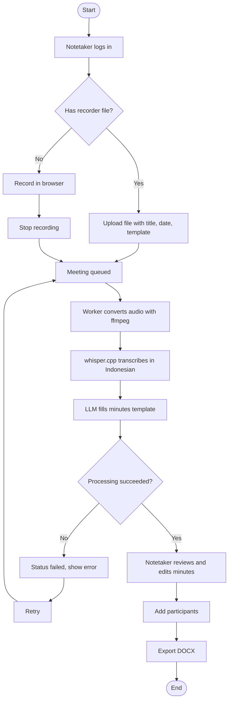
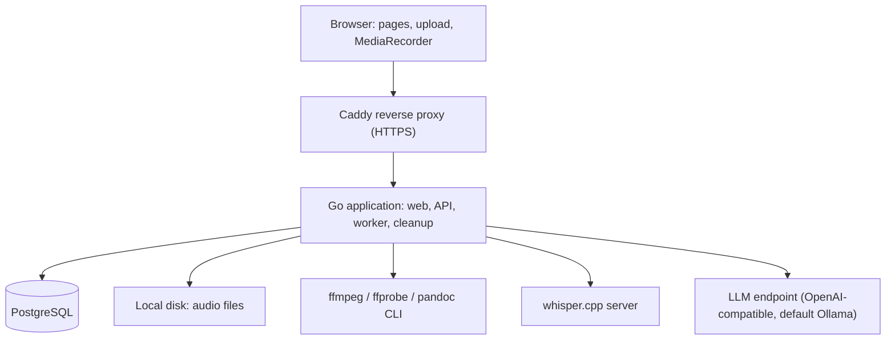
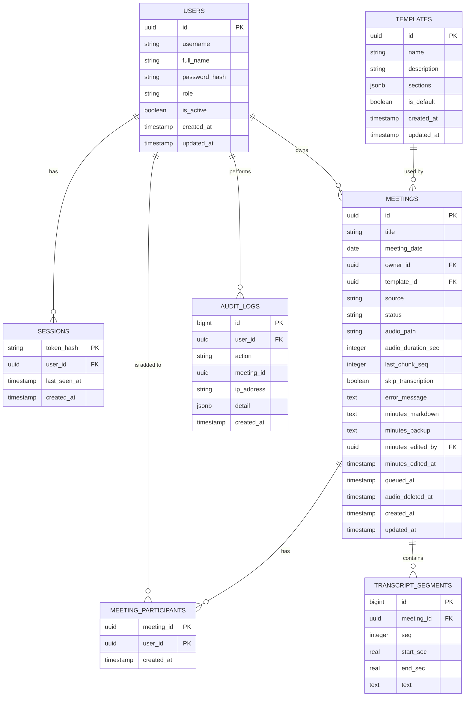

# PRODUCT REQUIREMENTS DOCUMENT (PRD)

**Product Name:** Notulensi AI (working name), a web-based AI meeting minutes tool  
**Document Version:** 1.0  
**Status:** Draft  
**Date:** 21 November 2026  
**Product Owner:** [To be decided: product owner on the company side]  

---

# 1. Overview

## 1.1 Background
Every month the company holds a meeting between managers and the board of directors. The discussion is recorded on a voice recorder, and someone then listens back to the recording and types the minutes (notulen) by hand. A two-hour meeting can take several hours to write up, the result depends on who writes it, and action items are easy to miss.

Meetily (github.com/Zackriya-Solutions/meetily, MIT License) already solves this problem as a desktop app: it records or imports audio, transcribes it locally with Whisper or Parakeet, and fills a summary template with an LLM. It does not fit the company as-is because:

- It is a desktop app (Tauri + Rust + Next.js). Each user would have to install it, download models, and keep meetings on their own laptop.
- Meetings are stored in a local SQLite file per machine, so there is no shared archive and no access control.
- Its summary prompts force English output (`ENGLISH_BASE_SUMMARY_INSTRUCTION` in `summary/processor.rs`), while the company needs minutes in Bahasa Indonesia.
- Team self-hosting is only offered in the paid Meetily PRO edition.

This product rebuilds the Meetily flow as an internal web application written in Go, so users only need a browser.

## 1.2 Product Goals
- Cut the time to produce minutes for a 2-hour meeting from several hours of manual typing to under 60 minutes of unattended processing plus a short review.
- Produce minutes in Bahasa Indonesia with a consistent structure: summary, discussion points, decisions, and action items with owner and due date.
- Keep all recordings, transcripts, and minutes inside company infrastructure, with role-based access.
- Support both existing recorder files and direct recording from the browser.

## 1.3 Product Description
Notulensi AI is a web application hosted on a company server. A notetaker either uploads a recording from the voice recorder or records the meeting directly from a laptop browser. The server converts the audio with ffmpeg, transcribes it with whisper.cpp, and sends the transcript to an LLM that fills a minutes template. The notetaker reviews and edits the minutes next to the timestamped transcript and audio player, then exports them as a Word document or Markdown. Managers and directors who attended can open the minutes of meetings they were added to.

The processing pipeline follows Meetily's design: audio normalization to 16 kHz mono, transcription into timestamped segments, map-reduce summarization for long transcripts (chunk, summarize each chunk, combine), and JSON-defined section templates.

## 1.4 Target Users
| Role | Description | Responsibilities |
|---|---|---|
| Admin | IT staff who run the application | Manage user accounts, manage minutes templates, view audit logs, manage any meeting |
| Notetaker | Secretariat or staff who take minutes (for example the requester's team) | Upload or record meetings, review and edit minutes, choose participants, export minutes |
| Viewer | Managers and directors who attend meetings | Read minutes, transcript, and audio of meetings they were added to, export minutes |

## 1.5 Product Scope

### In Scope
- Login with local accounts and role-based access (Admin, Notetaker, Viewer).
- Upload of recorder files (mp3, m4a, wav, aac, ogg, flac, webm, mp4).
- Direct recording from the browser microphone with chunked upload during recording.
- Background processing queue: audio conversion, transcription, minutes generation.
- Transcription in Bahasa Indonesia with segment timestamps.
- Minutes generation from configurable templates, written in Bahasa Indonesia.
- Review page with editable minutes, timestamped transcript, and audio playback.
- Regenerating minutes with another template, keeping the previous version.
- Export minutes to DOCX and Markdown.
- Meeting list with search by title and date range.
- Participant-based access to each meeting.
- Audit log of sensitive actions.
- Automatic deletion of audio files after a retention period.

### Out of Scope
- Real-time (live) transcription while the meeting is running. Live recordings are transcribed after they end.
- Capturing audio from Zoom, Google Meet, or other system audio. Recording uses the microphone only.
- Speaker diarization (labelling who said what). Planned as a future improvement.
- Single sign-on with LDAP or Active Directory in version 1.0.
- Native mobile apps and desktop apps.
- Calendar integration and automatic distribution of minutes by email.
- Porting Meetily's Rust code. The Rust code is used as a design reference only.

---

# 2. Requirements

## 2.1 Functional Requirements

| ID | Requirement | Description | Priority |
|---|---|---|---|
| FR-001 | Authentication | Users log in with username and password and log out. Sessions expire after 8 hours of inactivity. | High |
| FR-002 | User Management | Admin creates, edits, deactivates users and assigns one role per user. | High |
| FR-003 | Upload Recording | Notetaker uploads a recorder file with a title, meeting date, and template. | High |
| FR-004 | Browser Recording | Notetaker records from the browser microphone. Audio is sent to the server in 5-second chunks while recording. | High |
| FR-005 | Processing Queue | The server processes meetings one at a time in a background worker and shows the current status. | High |
| FR-006 | Transcription | The server converts audio to 16 kHz mono WAV and transcribes it into timestamped Indonesian segments. | High |
| FR-007 | Minutes Generation | The server generates minutes in Bahasa Indonesia by filling the chosen template from the transcript. | High |
| FR-008 | Template Management | Admin manages minutes templates made of named sections with instructions and formats. | Medium |
| FR-009 | Review and Edit Minutes | Notetaker edits minutes in Markdown next to the transcript and audio player. | High |
| FR-010 | Regenerate Minutes | Notetaker regenerates minutes with the same or another template. The previous version is kept as a backup. | Medium |
| FR-011 | Export Minutes | Users with access export minutes as DOCX or Markdown. | High |
| FR-012 | Meeting List and Search | Users see the meetings they can access and search by title and date range. | High |
| FR-013 | Meeting Access | The meeting owner adds or removes Viewer participants of a meeting. | High |
| FR-014 | Delete Meeting | Admin or the meeting owner deletes a meeting with all its data. | Medium |
| FR-015 | Audit Log | The system records login, view, edit, export, and delete actions. Admin can view the log. | Medium |
| FR-016 | Audio Retention | The system deletes audio files older than the retention period. Transcripts and minutes remain. | Medium |

## 2.2 Non-Functional Requirements

| ID | Category | Requirement | Description |
|---|---|---|---|
| NFR-001 | Security | Authentication & Authorization | Every API endpoint except login requires a valid session. Role and participant checks run on the server. |
| NFR-002 | Performance | Response Time | 95% of page and API requests, excluding uploads, exports, and audio streaming, complete in under 1 second. |
| NFR-003 | Performance | Processing Time | A 2-hour recording is fully processed (transcript and minutes) in under 60 minutes on the reference server in section 7.3. |
| NFR-004 | Scalability | Concurrent Use | The application supports 50 logged-in users at the same time, one active processing job, and up to 3 browser recordings in progress. |
| NFR-005 | Reliability | Recording Durability | If the browser closes during recording, at most the last 5 seconds of audio are lost. Everything already uploaded can still be processed. |
| NFR-006 | Reliability | Data Integrity | Processing failures never delete the uploaded audio. A failed job can be retried. |
| NFR-007 | Privacy | Data Residency | With the default configuration, audio, transcripts, and minutes never leave company servers. |
| NFR-008 | Usability | User Experience | A first-time notetaker can upload a file and reach the review page without training. All UI text is in Bahasa Indonesia. |
| NFR-009 | Compatibility | Browser Support | The application works on the latest two versions of Chrome, Edge, and Firefox on desktop. Browser recording also works on Safari 17+. |

## 2.3 Business Rules

| ID | Business Rule | Description |
|---|---|---|
| BR-001 | One role per user | Each user has exactly one role: Admin, Notetaker, or Viewer. |
| BR-002 | Meeting visibility | A meeting is visible to Admins, its owner (the user who created it), and users listed as its participants. |
| BR-003 | Edit rights | Only Admins and the meeting owner can edit minutes, regenerate minutes, change participants, or delete the meeting. |
| BR-004 | Minutes language | Minutes are always written in Bahasa Indonesia, whatever language is mixed into the transcript. |
| BR-005 | No invented content | Minutes may only contain information present in the transcript. Empty sections show "Tidak ada catatan untuk bagian ini." |
| BR-006 | Accepted audio | Accepted formats are mp3, m4a, wav, aac, ogg, flac, webm, and mp4. Maximum size is 1 GB and maximum duration is 4 hours. |
| BR-007 | Recording limit | A browser recording stops automatically at 4 hours. |
| BR-008 | One job at a time | The worker processes one meeting at a time in the order the meetings entered the queue. |
| BR-009 | Edited minutes protection | Regenerating minutes keeps the current minutes as a backup. Only one backup is kept. |
| BR-010 | Audio retention | Audio files are deleted 90 days after the meeting is created. The retention period is configurable. [To be decided: confirm 90 days with the company.] |
| BR-011 | Recording consent | Before a browser recording starts, the notetaker must confirm that participants were informed the meeting is being recorded. |
| BR-012 | Deactivated users | A deactivated user cannot log in, but meetings they own stay available to Admins and participants. |

## 2.4 Access Control & Permissions

| Module / Feature | Admin | Notetaker | Viewer |
|---|---|---|---|
| Login / logout | Yes | Yes | Yes |
| User management | Full Access | No | No |
| Template management | Full Access | View | No |
| Meeting list | All meetings | Own and participating | Participating only |
| Upload recording | Yes | Yes | No |
| Browser recording | Yes | Yes | No |
| View minutes, transcript, audio | Yes | Own and participating | Participating only |
| Edit minutes | Yes | Own only | No |
| Regenerate minutes | Yes | Own only | No |
| Manage participants | Yes | Own only | No |
| Export minutes | Yes | Own and participating | Participating only |
| Delete meeting | Yes | Own only | No |
| Retry failed processing | Yes | Own only | No |
| Audit log | View | No | No |

---

# 3. Core Features

## 3.1 Authentication

**Description:**  
Local username and password login with server-side sessions stored in the database.

**User Story:**  
As a user, I want to log in with my account so that only I can see the meetings I am allowed to see.

**Preconditions:**
- The user account exists and is active.

**Functional Behavior:**
1. The user submits username and password on the login page.
2. The server compares the password with the bcrypt hash and, if valid, creates a session row and sets an HttpOnly, Secure, SameSite=Lax cookie.
3. Each request refreshes the session's last activity time. Sessions idle for 8 hours are rejected.
4. Logout deletes the session row and clears the cookie.

**Input:**

| Field | Type | Required | Validation |
|---|---|---|---|
| username | String | Yes | 3–50 characters |
| password | String | Yes | 8–128 characters |

**Output:**
- Redirect to the meeting list page with a session cookie.

**Error Handling:**
- Wrong username or password: show "Username atau password salah." without saying which one is wrong.
- Deactivated account: show the same message as a wrong password.
- 5 failed attempts for one username within 15 minutes: block that username for 15 minutes.

**Acceptance Criteria:**
- [ ] Given an active user, when they submit correct credentials, then they land on the meeting list.
- [ ] Given a deactivated user, when they submit correct credentials, then login fails with the generic error.
- [ ] Given a session idle for more than 8 hours, when the user opens any page, then they are redirected to login.

## 3.2 User Management

**Description:**  
Admin manages accounts and roles.

**User Story:**  
As an Admin, I want to create accounts and set roles so that each person gets the right access.

**Preconditions:**
- The actor is logged in as Admin.

**Functional Behavior:**
1. Admin opens the user list and sees username, full name, role, and status.
2. Admin creates a user with an initial password. The password is stored as a bcrypt hash.
3. Admin edits full name or role, resets the password, or deactivates the user.
4. Deactivating a user deletes all of that user's sessions.

**Input:**

| Field | Type | Required | Validation |
|---|---|---|---|
| username | String | Yes | 3–50 characters, letters, digits, dot, underscore; unique |
| full_name | String | Yes | 1–255 characters |
| role | Enum | Yes | admin, notetaker, viewer |
| password | String | Yes on create | 8–128 characters |
| is_active | Boolean | No | Default true |

**Output:**
- Updated user list.

**Error Handling:**
- Duplicate username: show "Username sudah dipakai."
- Admin tries to deactivate or demote their own account: reject with "Tidak bisa mengubah akun sendiri."

**Acceptance Criteria:**
- [ ] Given an Admin, when they create a user with a unique username, then the user can log in with the initial password.
- [ ] Given an active user with a session, when Admin deactivates them, then their next request is redirected to login.

## 3.3 Upload Recording

**Description:**  
Upload of an existing recorder file. Based on Meetily's import flow (`audio/import.rs`), which validates extension, size, and duration before processing.

**User Story:**  
As a notetaker, I want to upload the recorder file after the monthly meeting so that I get draft minutes without typing them.

**Preconditions:**
- The actor is Admin or Notetaker.
- At least one template exists.

**Functional Behavior:**
1. The notetaker fills title, meeting date, template, optional participants, and selects a file.
2. The browser uploads the file with a progress bar.
3. The server checks extension, size, and duration with ffprobe.
4. The server stores the file, creates the meeting with status `queued`, and redirects to the meeting page.

**Input:**

| Field | Type | Required | Validation |
|---|---|---|---|
| title | String | Yes | 1–255 characters |
| meeting_date | Date | Yes | Not later than today |
| template_id | UUID | Yes | Existing template |
| participant_ids | UUID[] | No | Existing active users |
| file | File | Yes | BR-006 formats, ≤ 1 GB, ≤ 4 hours |

**Output:**
- Meeting page showing status "Dalam antrean" and the queue position.

**Error Handling:**
- Unsupported format: "Format file tidak didukung. Gunakan mp3, m4a, wav, aac, ogg, flac, webm, atau mp4."
- File over 1 GB or 4 hours: "File melebihi batas 1 GB atau 4 jam."
- ffprobe cannot read the file: "File audio rusak atau tidak bisa dibaca." The file is deleted.
- Upload interrupted: no meeting is created.

**Acceptance Criteria:**
- [ ] Given a 90-minute m4a file, when a notetaker uploads it, then a meeting with status `queued` is created.
- [ ] Given a .txt file renamed to .mp3, when it is uploaded, then the server rejects it as unreadable.
- [ ] Given a Viewer, when they call the upload endpoint, then the server returns 403.

## 3.4 Browser Recording

**Description:**  
Direct recording from the laptop microphone with `getUserMedia` and `MediaRecorder`. Audio is uploaded in chunks so a crash does not lose the meeting. Meetily achieves the same durability with incremental saving (`incremental_saver.rs`); here the server appends chunks to one file.

**User Story:**  
As a notetaker, I want to record the meeting directly from my laptop so that I do not need a separate recorder.

**Preconditions:**
- The actor is Admin or Notetaker.
- The site is served over HTTPS and the browser has microphone permission.

**Functional Behavior:**
1. The notetaker fills title, meeting date, template, and optional participants, then ticks the consent confirmation (BR-011).
2. The browser asks for microphone access and shows a live input level meter.
3. On start, the server creates a meeting with status `recording`. The browser sends a chunk every 5 seconds. The server appends each chunk to the meeting's audio file in sequence order.
4. The page requests a Screen Wake Lock and shows elapsed time.
5. On stop, or at 4 hours, the browser sends the last chunk and calls finish. The server sets status `queued`.
6. If the browser closes, the meeting stays `recording`. The owner can open it and choose "Proses rekaman yang tersimpan" to queue the audio already received.

**Input:**

| Field | Type | Required | Validation |
|---|---|---|---|
| title | String | Yes | 1–255 characters |
| meeting_date | Date | Yes | Not later than today |
| template_id | UUID | Yes | Existing template |
| participant_ids | UUID[] | No | Existing active users |
| consent_confirmed | Boolean | Yes | Must be true |
| chunk | Binary | Yes per chunk | ≤ 5 MB per chunk |
| seq | Integer | Yes per chunk | Equal to last received seq + 1 |

**Output:**
- During recording: elapsed time and level meter.
- After stop: meeting page with status "Dalam antrean".

**Error Handling:**
- Microphone permission denied: "Izin mikrofon ditolak. Aktifkan izin mikrofon di browser."
- No microphone found: "Mikrofon tidak ditemukan."
- Chunk upload fails: the browser retries that chunk every 5 seconds and shows "Koneksi terputus, mencoba lagi". Later chunks wait in browser memory in order.
- Out-of-order seq: server returns 409 with the expected seq.

**Acceptance Criteria:**
- [ ] Given a 10-minute browser recording, when the notetaker stops it, then the meeting is queued and the stored audio is about 10 minutes long.
- [ ] Given a recording in progress, when the tab is closed at minute 30, then the owner can queue the stored audio and it is at least 29 minutes 55 seconds long.
- [ ] Given the consent box is not ticked, when the notetaker presses start, then recording does not start.

## 3.5 Processing Queue

**Description:**  
A single background worker in the Go process picks the oldest `queued` meeting and runs the pipeline. Meetily allows one import at a time with an `ImportGuard`; this product keeps the same one-job rule (BR-008) across all users.

**User Story:**  
As a notetaker, I want to see where my meeting is in processing so that I know when the minutes are ready.

**Preconditions:**
- At least one meeting has status `queued`.

**Functional Behavior:**
1. The worker polls the database every 5 seconds for the oldest `queued` meeting and marks it `transcribing`.
2. After transcription it marks the meeting `summarizing`, then `done`.
3. On any error it marks the meeting `failed` and stores the error message.
4. The meeting page polls status every 5 seconds and shows the status label and queue position.
5. On server start, meetings left in `transcribing` or `summarizing` are reset to `queued`.
6. The owner or Admin can retry a `failed` meeting, which sets it back to `queued`.

**Input:**

| Field | Type | Required | Validation |
|---|---|---|---|
| meeting_id | UUID | Yes (retry) | Meeting in status `failed` |

**Output:**
- Status labels: Merekam, Dalam antrean, Mentranskrip, Menyusun notulen, Selesai, Gagal.

**Error Handling:**
- whisper server unreachable: status `failed`, message "Layanan transkripsi tidak tersedia."
- LLM unreachable: status `failed`, message "Layanan AI tidak tersedia." The transcript is kept, so retry skips transcription.

**Acceptance Criteria:**
- [ ] Given two queued meetings, when the worker runs, then the older one finishes before the newer one starts.
- [ ] Given a meeting that failed at the LLM step, when it is retried, then transcription is not run again.
- [ ] Given the server restarts during transcription, when it comes back, then the meeting is processed again from the start.

## 3.6 Transcription

**Description:**  
ffmpeg converts the audio to 16 kHz mono WAV, the input format Meetily's pipeline sends to Whisper. whisper.cpp runs as a separate HTTP server with voice activity detection enabled, language fixed to Indonesian, and returns segments with start and end times.

**User Story:**  
As a notetaker, I want an accurate transcript with timestamps so that I can check what was said when reviewing the minutes.

**Preconditions:**
- Meeting status is `transcribing` and its audio file exists.

**Functional Behavior:**
1. The worker runs `ffmpeg -i <input> -ar 16000 -ac 1 -c:a pcm_s16le <work>.wav`.
2. The worker posts the WAV to the whisper.cpp server with `language=id` and `response_format=verbose_json`.
3. The worker saves each segment with sequence number, start time, end time, and text.
4. The worker stores the total audio duration on the meeting.
5. The temporary WAV file is deleted.

**Input:**

| Field | Type | Required | Validation |
|---|---|---|---|
| audio file | File | Yes | Stored meeting audio |

**Output:**
- Transcript segments shown on the review page as `[mm:ss] text`.

**Error Handling:**
- ffmpeg fails: status `failed`, "Konversi audio gagal."
- whisper returns no segments: status `failed`, "Tidak ada suara yang terdeteksi di rekaman."

**Acceptance Criteria:**
- [ ] Given a clear 5-minute Indonesian recording, when it is transcribed, then segments are saved with increasing start times covering the whole recording.
- [ ] Given a silent recording, when it is transcribed, then the meeting fails with the no-speech message.

## 3.7 Minutes Generation

**Description:**  
The LLM fills the meeting's template from the transcript. The prompts follow Meetily's `summary/processor.rs` design, with the English-only instruction replaced by an Indonesian one. Long transcripts use Meetily's map-reduce approach: estimate tokens as characters × 0.35, split into overlapping chunks when the transcript exceeds the token threshold, summarize each chunk, combine the summaries, then fill the template.

**User Story:**  
As a notetaker, I want the system to draft the minutes in our standard format so that I only need to review and correct them.

**Preconditions:**
- Transcript segments exist for the meeting.

**Functional Behavior:**
1. The worker joins the segments into text with `[mm:ss]` markers.
2. If the estimated token count is below `LLM_TOKEN_THRESHOLD` (default 6000), the whole text goes into one final prompt.
3. Otherwise the text is split into chunks of `LLM_TOKEN_THRESHOLD − 300` tokens with 100 tokens overlap. Each chunk is summarized, the summaries are combined, and the combined text goes into the final prompt.
4. The final prompt contains the template sections and their instructions and requires: Bahasa Indonesia only, only facts from the transcript, "Tidak ada catatan untuk bagian ini." for empty sections, Markdown output only.
5. The worker strips any reasoning blocks such as `<think>` from the output, saves the Markdown as the meeting minutes, and sets status `done`.

**Input:**

| Field | Type | Required | Validation |
|---|---|---|---|
| transcript | Text | Yes | At least one segment |
| template | JSON | Yes | Template linked to the meeting |

**Output:**
- Minutes in Markdown, for example sections Ringkasan, Pokok Pembahasan, Keputusan, Tindak Lanjut (table of PIC, task, due date, timestamp).

**Error Handling:**
- LLM error or timeout (5 minutes per call): retry the call once, then fail with "Penyusunan notulen gagal."
- Empty output after cleaning: fail with "AI tidak menghasilkan notulen."

**Acceptance Criteria:**
- [ ] Given a transcript where a director assigns a task to a manager with a deadline, when minutes are generated, then the action item table lists that manager, task, and deadline.
- [ ] Given a transcript longer than the threshold, when minutes are generated, then the result covers topics from the first and last 10 minutes of the meeting.
- [ ] Given any transcript, when minutes are generated, then the output is in Bahasa Indonesia.

## 3.8 Template Management

**Description:**  
Templates use Meetily's JSON format: a name, description, and ordered sections, each with title, instruction, format (`paragraph`, `list`, or `table`), and optional item format.

**User Story:**  
As an Admin, I want to define the company's minutes format so that every meeting produces minutes in the same structure.

**Preconditions:**
- The actor is Admin.

**Functional Behavior:**
1. Admin sees the template list. One template is marked default.
2. Admin creates or edits a template: name, description, and a list of sections that can be added, removed, and reordered.
3. Admin sets one template as default. The default is preselected on upload and recording forms.
4. A template used by any meeting cannot be deleted, only edited.
5. On first start the system seeds "Rapat Bulanan Manajemen" (Ringkasan, Peserta yang Disebut, Pokok Pembahasan, Keputusan, Tindak Lanjut) as default.

**Input:**

| Field | Type | Required | Validation |
|---|---|---|---|
| name | String | Yes | 1–100 characters, unique |
| description | String | No | ≤ 500 characters |
| sections[].title | String | Yes | 1–100 characters |
| sections[].instruction | String | Yes | 1–1000 characters |
| sections[].format | Enum | Yes | paragraph, list, table |
| sections[].item_format | String | No | Required when format is table |

**Output:**
- Saved template available on the meeting forms.

**Error Handling:**
- No sections: "Template harus memiliki minimal satu bagian."
- Delete a template in use: "Template sedang dipakai oleh rapat dan tidak bisa dihapus."

**Acceptance Criteria:**
- [ ] Given a new template with three sections, when a meeting is processed with it, then the minutes contain exactly those three section headings in order.
- [ ] Given a template used by a meeting, when Admin deletes it, then the deletion is rejected.

## 3.9 Review and Edit Minutes

**Description:**  
A meeting page with the minutes editor on the left and the transcript with audio player on the right.

**User Story:**  
As a notetaker, I want to correct the AI draft while checking the transcript and audio so that the final minutes are accurate.

**Preconditions:**
- Meeting status is `done`.
- The actor can view the meeting (BR-002). Editing requires BR-003.

**Functional Behavior:**
1. The page shows the minutes rendered from Markdown. Owners and Admins can switch to edit mode, which shows a Markdown textarea with a live preview.
2. Saving stores the Markdown and records the editor and time.
3. The transcript lists segments with timestamps. Clicking a segment plays the audio from that time.
4. Timestamps such as `[12:34]` inside the minutes are clickable and seek the audio.
5. If the audio was deleted by retention, the player is hidden and the page shows "Audio sudah dihapus sesuai kebijakan retensi."

**Input:**

| Field | Type | Required | Validation |
|---|---|---|---|
| minutes_markdown | Text | Yes | 1–200,000 characters |
| updated_at | Timestamp | Yes | Must match the stored value |

**Output:**
- Saved minutes and "Notulen tersimpan."

**Error Handling:**
- Someone else saved in the meantime (updated_at mismatch): "Notulen sudah diubah oleh pengguna lain. Muat ulang halaman." The save is rejected.
- Empty minutes: "Notulen tidak boleh kosong."

**Acceptance Criteria:**
- [ ] Given an owner editing minutes, when they save, then reloading the page shows the edited text.
- [ ] Given a Viewer participant, when they open the meeting, then no edit button is shown and the save endpoint returns 403.
- [ ] Given a transcript segment at 05:10, when the user clicks it, then audio playback starts at 05:10.

## 3.10 Regenerate Minutes

**Description:**  
Runs minutes generation again on the stored transcript, like Meetily's regenerate feature with `result_backup`.

**User Story:**  
As a notetaker, I want to regenerate minutes with another template without losing my current version.

**Preconditions:**
- Meeting status is `done` and the actor is owner or Admin.

**Functional Behavior:**
1. The user chooses a template and confirms.
2. The server copies the current minutes to the backup field and sets status `queued` with a flag to skip transcription.
3. After generation the new minutes replace the current ones.
4. The user can restore the backup, which swaps current and backup minutes.

**Input:**

| Field | Type | Required | Validation |
|---|---|---|---|
| template_id | UUID | Yes | Existing template |

**Output:**
- New minutes, with a "Kembalikan versi sebelumnya" button while a backup exists.

**Error Handling:**
- Generation fails: status `failed`, current minutes are restored from the backup.

**Acceptance Criteria:**
- [ ] Given edited minutes, when the user regenerates, then the edited version can be restored from the backup.
- [ ] Given a regeneration, when it runs, then no new transcript segments are created.

## 3.11 Export Minutes

**Description:**  
Converts the Markdown minutes to DOCX with pandoc, or returns the Markdown file.

**User Story:**  
As a notetaker, I want to download the minutes as a Word document so that I can circulate them in the usual format.

**Preconditions:**
- Meeting status is `done` and the actor can view the meeting.

**Functional Behavior:**
1. The user chooses DOCX or Markdown.
2. The server adds a header with title, meeting date, and participants, then converts with pandoc using a company reference document (`reference.docx`) for styles.
3. The file downloads as `Notulen-<YYYY-MM-DD>-<title>.docx` or `.md`.

**Input:**

| Field | Type | Required | Validation |
|---|---|---|---|
| format | Enum | Yes | docx, md |

**Output:**
- DOCX or Markdown file.

**Error Handling:**
- pandoc fails: "Ekspor gagal. Coba lagi atau unduh versi Markdown."

**Acceptance Criteria:**
- [ ] Given minutes with a table, when exported to DOCX, then the table opens as a Word table.
- [ ] Given a Viewer participant, when they export, then the download succeeds.

## 3.12 Meeting List and Search

**Description:**  
The home page lists meetings the user can access.

**User Story:**  
As a director, I want to find last quarter's meeting minutes quickly.

**Preconditions:**
- The user is logged in.

**Functional Behavior:**
1. The list shows title, meeting date, owner, status, and duration, newest meeting date first, 20 per page.
2. The user filters by title text and date range.
3. Results follow BR-002.

**Input:**

| Field | Type | Required | Validation |
|---|---|---|---|
| q | String | No | ≤ 100 characters |
| date_from | Date | No | ≤ date_to |
| date_to | Date | No | ≥ date_from |
| page | Integer | No | ≥ 1 |

**Output:**
- Paginated meeting list.

**Error Handling:**
- No results: "Belum ada rapat yang cocok."
- date_from after date_to: "Rentang tanggal tidak valid."

**Acceptance Criteria:**
- [ ] Given a Viewer added to 2 of 10 meetings, when they open the list, then they see exactly those 2.
- [ ] Given a search for "Oktober", when meetings with that word in the title exist, then only those are listed.

## 3.13 Meeting Access

**Description:**  
The owner chooses which users can view a meeting.

**User Story:**  
As a notetaker, I want to add the attending directors to the meeting so that they can read the minutes.

**Preconditions:**
- The actor is the owner or Admin.

**Functional Behavior:**
1. The meeting page shows the participant list.
2. The owner adds or removes users by searching active users by name.
3. Changes take effect on the next request of the affected user.

**Input:**

| Field | Type | Required | Validation |
|---|---|---|---|
| participant_ids | UUID[] | Yes | Active users, owner excluded |

**Output:**
- Updated participant list.

**Error Handling:**
- Inactive user id: "Pengguna tidak aktif tidak bisa ditambahkan."

**Acceptance Criteria:**
- [ ] Given a Viewer removed from a meeting, when they open its URL, then the server returns 404.

## 3.14 Delete Meeting

**Description:**  
Permanently deletes a meeting, its audio, transcript, minutes, and participants.

**User Story:**  
As an owner, I want to delete a wrong upload so that it does not clutter the archive.

**Preconditions:**
- The actor is the owner or Admin. The meeting is not `transcribing` or `summarizing`.

**Functional Behavior:**
1. The user confirms by typing the meeting title.
2. The server deletes the database rows and the audio file and writes an audit log entry.

**Input:**

| Field | Type | Required | Validation |
|---|---|---|---|
| confirm_title | String | Yes | Must equal the meeting title |

**Output:**
- Redirect to the meeting list with "Rapat dihapus."

**Error Handling:**
- Meeting is processing: "Rapat sedang diproses dan tidak bisa dihapus."

**Acceptance Criteria:**
- [ ] Given a deleted meeting, when anyone opens its URL, then the server returns 404 and the audio file no longer exists on disk.

## 3.15 Audit Log

**Description:**  
Append-only record of sensitive actions for accountability, because minutes of board meetings are confidential.

**User Story:**  
As an Admin, I want to see who opened or exported a meeting.

**Preconditions:**
- The actor is Admin.

**Functional Behavior:**
1. The system writes an entry for: login success, login failure, meeting view, minutes edit, regenerate, export, participant change, meeting delete, user change.
2. Each entry stores time, user, action, meeting id if any, and IP address.
3. Admin filters the log by user, action, and date range.

**Input:**

| Field | Type | Required | Validation |
|---|---|---|---|
| user_id | UUID | No | Existing user |
| action | Enum | No | One of the logged actions |
| date_from / date_to | Date | No | Valid range |

**Output:**
- Paginated audit log, 50 entries per page.

**Error Handling:**
- No entries: "Tidak ada aktivitas."

**Acceptance Criteria:**
- [ ] Given a Viewer exports minutes, when Admin opens the audit log, then an export entry with that user and meeting is shown.

## 3.16 Audio Retention

**Description:**  
Daily cleanup of old audio files to limit storage and exposure of raw recordings.

**User Story:**  
As an Admin, I want old recordings removed automatically so that the server does not keep sensitive audio forever.

**Preconditions:**
- `AUDIO_RETENTION_DAYS` is set (default 90).

**Functional Behavior:**
1. Once a day at 02:00 server time, the system finds meetings with status `done` created more than `AUDIO_RETENTION_DAYS` ago that still have audio.
2. It deletes the audio file and sets `audio_deleted_at`.
3. Transcript and minutes are kept.

**Input:**

| Field | Type | Required | Validation |
|---|---|---|---|
| AUDIO_RETENTION_DAYS | Integer (env) | Yes | 1–3650 |

**Output:**
- Meetings marked with deleted audio.

**Error Handling:**
- File already missing: set `audio_deleted_at` and continue.

**Acceptance Criteria:**
- [ ] Given a done meeting created 91 days ago with retention 90, when cleanup runs, then its audio file is deleted and its minutes still open.

---

# 4. User Flow

## 4.1 Main User Flow

## 4.2 Role-Based User Flow

### Admin Flow
- Log in and create accounts for notetakers, managers, and directors.
- Review or edit the default "Rapat Bulanan Manajemen" template.
- Monitor the meeting list and retry failed processing when needed.
- Check the audit log when access questions come up.

### Notetaker Flow
- Log in and choose upload or browser recording.
- Fill title, date, template, and participants, then start.
- Wait for status "Selesai", then review the minutes against the transcript and audio.
- Edit, optionally regenerate with another template, and export to DOCX.

### Viewer Flow
- Log in and open the meeting list, which shows only meetings they were added to.
- Open a meeting to read the minutes and listen to parts of the audio.
- Export the minutes if needed.

## 4.3 Exception & Alternative Flow
- **Browser closed during recording:** the meeting stays `recording`. The owner opens it and selects "Proses rekaman yang tersimpan" to queue the received audio.
- **Network drop during recording:** the browser keeps recording, keeps chunks in order, and resends them when the connection returns.
- **Processing fails at transcription:** retry runs the full pipeline. **At minutes generation:** retry reuses the transcript.
- **Server restart during processing:** the meeting returns to `queued` and is processed again.
- **Unsatisfying minutes:** the owner regenerates with another template and can restore the previous version.
- **Wrong upload:** the owner deletes the meeting.
- **Audio deleted by retention:** minutes and transcript stay readable; the player is hidden.

---

# 5. Architecture

## 5.1 System Architecture

The application is one Go binary that serves HTML pages, the JSON API, and the background worker. whisper.cpp and the LLM run as separate HTTP services. This replaces Meetily's Tauri command/event bridge with plain HTTP and replaces local SQLite with a shared PostgreSQL database.

## 5.2 Technology Stack

| Layer | Technology | Purpose |
|---|---|---|
| Frontend | Go `html/template`, vanilla JavaScript, plain CSS | Server-rendered pages, upload progress, MediaRecorder, audio player |
| Backend | Go 1.23, `net/http` ServeMux | Business logic, API, background worker |
| Database | PostgreSQL 16 with `pgx` | Users, meetings, transcripts, minutes, templates, audit log |
| Authentication | Session table + bcrypt (`golang.org/x/crypto`) | Login and session management |
| Storage | Local disk volume | Audio files |
| Audio processing | ffmpeg 6 / ffprobe | Validation and conversion to 16 kHz mono WAV |
| Transcription | whisper.cpp server, model `large-v3-turbo` | Indonesian speech-to-text with VAD |
| Summarization | OpenAI-compatible chat API, default Ollama | Minutes generation |
| Markdown | goldmark | Render minutes to HTML |
| Export | pandoc 3 | Markdown to DOCX |
| Deployment | Docker Compose, Caddy | Hosting on the company server with HTTPS |

## 5.3 API Design

| Method | Endpoint | Description | Access |
|---|---|---|---|
| POST | /api/auth/login | Log in | Public |
| POST | /api/auth/logout | Log out | Authenticated |
| GET | /api/me | Current user profile | Authenticated |
| GET | /api/users | List users | Admin |
| POST | /api/users | Create user | Admin |
| PUT | /api/users/{id} | Update user, reset password, deactivate | Admin |
| GET | /api/users/options | Active users for the participant picker | Admin, Notetaker |
| GET | /api/templates | List templates | Admin, Notetaker |
| POST | /api/templates | Create template | Admin |
| PUT | /api/templates/{id} | Update template or set default | Admin |
| DELETE | /api/templates/{id} | Delete unused template | Admin |
| GET | /api/meetings | List accessible meetings with search | Authenticated |
| POST | /api/meetings | Upload recording and create meeting | Admin, Notetaker |
| POST | /api/recordings | Start browser recording, create meeting | Admin, Notetaker |
| POST | /api/recordings/{id}/chunks | Append audio chunk | Admin, Notetaker (owner) |
| POST | /api/recordings/{id}/finish | Finish recording and queue it | Admin, Notetaker (owner) |
| GET | /api/meetings/{id} | Meeting detail, status, minutes | Admin, owner, participant |
| GET | /api/meetings/{id}/transcript | Transcript segments | Admin, owner, participant |
| GET | /api/meetings/{id}/audio | Stream audio with range requests | Admin, owner, participant |
| PUT | /api/meetings/{id}/minutes | Save edited minutes | Admin, owner |
| POST | /api/meetings/{id}/regenerate | Regenerate minutes | Admin, owner |
| POST | /api/meetings/{id}/restore-backup | Swap current and backup minutes | Admin, owner |
| POST | /api/meetings/{id}/retry | Retry failed processing | Admin, owner |
| PUT | /api/meetings/{id}/participants | Replace participant list | Admin, owner |
| GET | /api/meetings/{id}/export | Export minutes (`format=docx` or `md`) | Admin, owner, participant |
| DELETE | /api/meetings/{id} | Delete meeting | Admin, owner |
| GET | /api/audit-logs | Audit log with filters | Admin |

## 5.4 Data Flow
1. **Upload:** the browser posts multipart data to `/api/meetings`. Go streams the file to `data/audio/<meeting_id>.<ext>`, runs ffprobe, and inserts the meeting with status `queued`.
2. **Browser recording:** `/api/recordings` inserts a meeting with status `recording`. Each chunk is appended to `data/audio/<meeting_id>.webm` (or `.mp4` on Safari). `/finish` sets status `queued`.
3. **Transcription:** the worker runs ffmpeg to a temporary WAV, posts it to whisper.cpp, and inserts rows into `transcript_segments`.
4. **Minutes:** the worker builds the prompt from segments and the template, calls the LLM (one or more calls), and writes `meetings.minutes_markdown`.
5. **Review:** the browser fetches meeting, transcript, and audio over the API. Edits go to `PUT /minutes`.
6. **Export:** Go writes the Markdown to a temp file, runs pandoc, and streams the DOCX back.
7. **External calls:** only whisper.cpp and the LLM endpoint. With default settings both run on company servers. Setting `LLM_BASE_URL` to a cloud provider sends transcripts outside the company and requires management approval.

---

# 6. Database Schema

## 6.1 Entity Relationship Diagram (ERD)

## 6.2 Table Specification

### Table: users

| Column | Data Type | Constraint | Description |
|---|---|---|---|
| id | UUID | PK | Primary key |
| username | VARCHAR(50) | UNIQUE, NOT NULL | Login name |
| full_name | VARCHAR(255) | NOT NULL | Display name |
| password_hash | TEXT | NOT NULL | bcrypt hash, cost 12 |
| role | VARCHAR(20) | NOT NULL, CHECK in (admin, notetaker, viewer) | User role |
| is_active | BOOLEAN | NOT NULL, DEFAULT true | Active flag |
| created_at | TIMESTAMPTZ | NOT NULL | Creation time |
| updated_at | TIMESTAMPTZ | NOT NULL | Last update time |

### Table: sessions

| Column | Data Type | Constraint | Description |
|---|---|---|---|
| token_hash | CHAR(64) | PK | SHA-256 of the session token |
| user_id | UUID | FK users.id ON DELETE CASCADE, NOT NULL | Session owner |
| last_seen_at | TIMESTAMPTZ | NOT NULL | Last activity |
| created_at | TIMESTAMPTZ | NOT NULL | Creation time |

### Table: templates

| Column | Data Type | Constraint | Description |
|---|---|---|---|
| id | UUID | PK | Primary key |
| name | VARCHAR(100) | UNIQUE, NOT NULL | Template name |
| description | VARCHAR(500) | NULL | Description |
| sections | JSONB | NOT NULL | Array of {title, instruction, format, item_format} |
| is_default | BOOLEAN | NOT NULL, DEFAULT false | Default template flag |
| created_at | TIMESTAMPTZ | NOT NULL | Creation time |
| updated_at | TIMESTAMPTZ | NOT NULL | Last update time |

### Table: meetings

| Column | Data Type | Constraint | Description |
|---|---|---|---|
| id | UUID | PK | Primary key |
| title | VARCHAR(255) | NOT NULL | Meeting title |
| meeting_date | DATE | NOT NULL | Date the meeting took place |
| owner_id | UUID | FK users.id, NOT NULL | Creator |
| template_id | UUID | FK templates.id, NOT NULL | Template for minutes |
| source | VARCHAR(10) | NOT NULL, CHECK in (upload, browser) | How audio arrived |
| status | VARCHAR(20) | NOT NULL, CHECK in (recording, queued, transcribing, summarizing, done, failed) | Processing status |
| audio_path | TEXT | NOT NULL | Path relative to the data directory |
| audio_duration_sec | INTEGER | NULL | Duration after processing |
| last_chunk_seq | INTEGER | NOT NULL, DEFAULT 0 | Last appended chunk for browser recordings |
| skip_transcription | BOOLEAN | NOT NULL, DEFAULT false | Set on regenerate and on retry after a summary failure |
| error_message | TEXT | NULL | Last processing error |
| minutes_markdown | TEXT | NULL | Current minutes |
| minutes_backup | TEXT | NULL | Previous minutes |
| minutes_edited_by | UUID | FK users.id, NULL | Last manual editor |
| minutes_edited_at | TIMESTAMPTZ | NULL | Last manual edit time |
| queued_at | TIMESTAMPTZ | NULL | Time the meeting entered the queue |
| audio_deleted_at | TIMESTAMPTZ | NULL | Time audio was deleted by retention |
| created_at | TIMESTAMPTZ | NOT NULL | Creation time |
| updated_at | TIMESTAMPTZ | NOT NULL | Last update, used for edit conflict checks |

### Table: meeting_participants

| Column | Data Type | Constraint | Description |
|---|---|---|---|
| meeting_id | UUID | PK, FK meetings.id ON DELETE CASCADE | Meeting |
| user_id | UUID | PK, FK users.id | Participant |
| created_at | TIMESTAMPTZ | NOT NULL | Time added |

### Table: transcript_segments

| Column | Data Type | Constraint | Description |
|---|---|---|---|
| id | BIGSERIAL | PK | Primary key |
| meeting_id | UUID | FK meetings.id ON DELETE CASCADE, NOT NULL | Meeting |
| seq | INTEGER | NOT NULL, UNIQUE with meeting_id | Order of the segment |
| start_sec | REAL | NOT NULL | Start time in seconds |
| end_sec | REAL | NOT NULL | End time in seconds |
| text | TEXT | NOT NULL | Segment text |

### Table: audit_logs

| Column | Data Type | Constraint | Description |
|---|---|---|---|
| id | BIGSERIAL | PK | Primary key |
| user_id | UUID | FK users.id, NULL | Actor; NULL for failed login with unknown username |
| action | VARCHAR(40) | NOT NULL | Action name |
| meeting_id | UUID | NULL | Related meeting; no FK so entries survive deletion |
| ip_address | VARCHAR(45) | NOT NULL | Client IP |
| detail | JSONB | NULL | Extra data, never minutes or transcript text |
| created_at | TIMESTAMPTZ | NOT NULL | Event time |

## 6.3 Database Constraints & Indexing
- Foreign keys on all relations. Deleting a meeting cascades to participants and transcript segments.
- Unique: `users.username`, `templates.name`, `(transcript_segments.meeting_id, seq)`.
- Partial unique index so only one template has `is_default = true`.
- Indexes: `meetings(status, queued_at)` for the worker, `meetings(owner_id)`, `meetings(meeting_date)`, `meeting_participants(user_id)`, `audit_logs(created_at)`, `audit_logs(user_id)`.
- Users are never deleted, only deactivated, so ownership and audit references stay valid.
- No soft delete for meetings. Deletion is permanent and recorded in the audit log.

## 6.4 Data Lifecycle
- **Audio:** created on upload or recording, read during processing and playback, deleted after `AUDIO_RETENTION_DAYS` or when the meeting is deleted.
- **Transcript segments:** created once per meeting during transcription, never edited, deleted with the meeting.
- **Minutes:** created by the worker, edited by owners and Admins, one backup kept on regenerate, deleted with the meeting.
- **Sessions:** created on login, deleted on logout, deactivation, or when idle for 8 hours (cleanup runs with the daily job).
- **Audit logs:** append-only, kept for 2 years, then deleted by the daily job. [To be decided: confirm audit retention with the company.]
- **Temporary files:** WAV and export files are deleted right after use.

---

# 7. Design & Technical Constraints

## 7.1 UI/UX Guidelines
- All UI text in Bahasa Indonesia.
- Desktop-first layout. The review page uses two columns at 1280 px and wider and stacks on smaller screens.
- Status labels with clear colors: grey for queued, blue for processing, green for done, red for failed.
- Loading, empty, success, and error states on every list and form.
- Confirmation dialogs for delete, regenerate, and stopping a recording.
- The recording page shows elapsed time, an input level meter, and a warning not to close the tab.

## 7.2 Security Requirements
- Passwords hashed with bcrypt (cost 12). Session tokens are 32 random bytes; only their SHA-256 hash is stored.
- Session cookie is HttpOnly, Secure, SameSite=Lax.
- All role and participant checks run in Go handlers. Inaccessible meetings return 404 so their existence is not revealed.
- State-changing requests require a CSRF token tied to the session.
- All SQL uses parameterized queries through pgx.
- Minutes HTML is rendered with goldmark with raw HTML disabled to prevent XSS.
- Uploaded files are validated by extension and ffprobe and stored under server-generated names. User input never builds a file path or shell command.
- Secrets (database URL, LLM API key) come from environment variables only.
- The application is reachable only on the company network, behind HTTPS.
- Audit log entries never include transcript or minutes text.

## 7.3 Technical Constraints
| Category | Constraint |
|---|---|
| Infrastructure | Reference server: 8-core CPU, 32 GB RAM, NVIDIA GPU with ≥ 8 GB VRAM, 500 GB SSD. [To be decided: actual server available at the company.] |
| Deployment | Docker Compose with services app, postgres, whisper, ollama, caddy |
| Database | PostgreSQL 16 |
| Integration | whisper.cpp server HTTP API; OpenAI-compatible `/v1/chat/completions` |
| Browser | Latest two versions of Chrome, Edge, Firefox; Safari 17+ for recording |
| Storage | About 1 GB per 4 hours of audio as uploaded; browser recordings at 64 kbps Opus use about 115 MB per 4 hours |
| Network | HTTPS required for microphone access; internal CA certificate via Caddy |

## 7.4 Assumptions & Dependencies
- Meetings are held in Bahasa Indonesia, sometimes mixed with English terms.
- Recordings come from a voice recorder or a laptop placed on the meeting table. A USB conference microphone is recommended for rooms with more than 8 people.
- The company provides a server with a GPU. Without a GPU, whisper.cpp still works but NFR-003 will not be met.
- The default LLM runs locally on Ollama. [To be decided: whether management allows sending transcripts to a cloud LLM such as Claude or GPT for better minutes quality.]
- [To be decided: the company's official minutes format, to be used for the default template and `reference.docx`.]
- Meetily's source code (MIT License) is used as a design reference for the pipeline, prompts, chunking, and template format.

## 7.5 Future Improvements
- Speaker diarization (for example pyannote in a separate service) to label speakers in the transcript and minutes.
- LDAP or Active Directory login.
- Email distribution of minutes to participants.
- Action item tracking across meetings with status and reminders.
- Search inside transcript and minutes text.
- Live transcription during browser recording.
- Running more than one processing job at a time when the server allows it.

---

# Document Revision History

| Version | Date | Changes | Author |
|---|---|---|---|
| 1.0 | 21 November 2026 | Initial PRD | Riezqi Dhermatria Rachmadi |

---

# Approval

| Role | Name | Status |
|---|---|---|
| Product Owner | [To be decided] | Pending |
| Technical Lead | Riezqi Dhermatria Rachmadi | Pending |
| Stakeholder | Ignasius Kukuh Damarjati | Pending |
