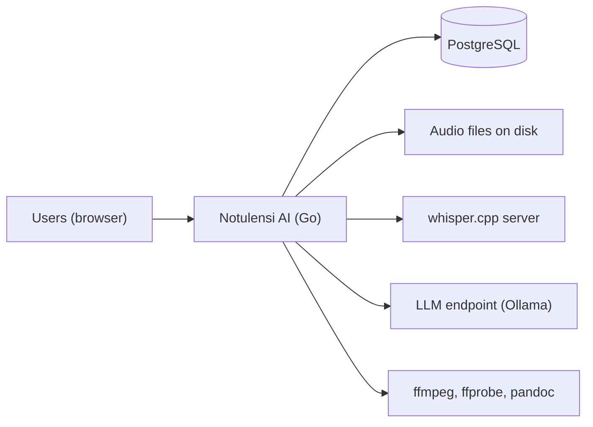
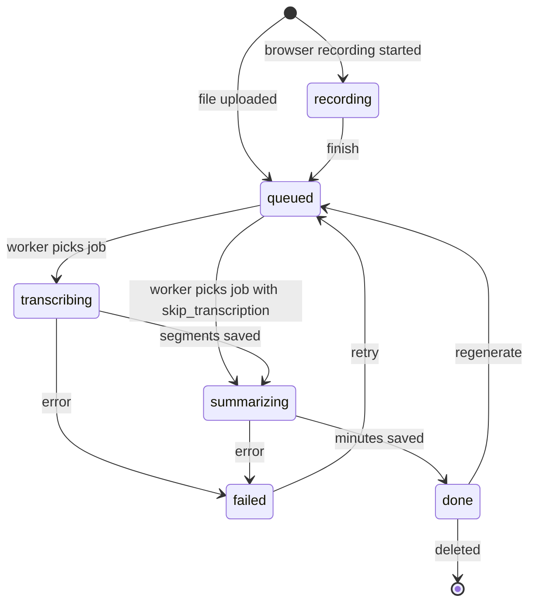
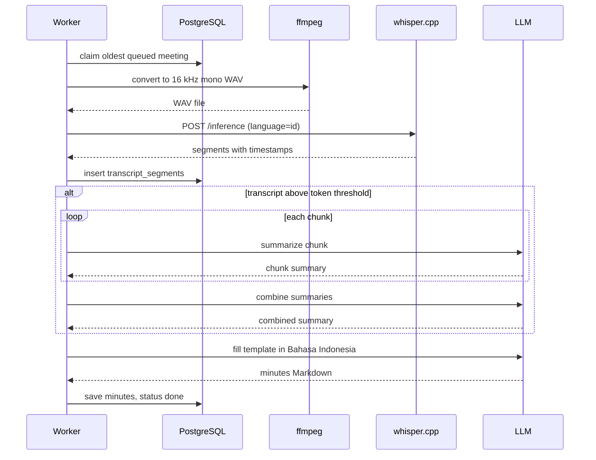
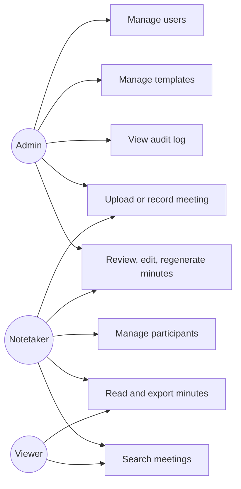

# SOFTWARE REQUIREMENTS SPECIFICATION (SRS)

**Product Name:** Notulensi AI (working name), a web-based AI meeting minutes tool  
**Document Version:** 1.0  
**Status:** Draft  
**Date:** 21 November 2026  
**Author:** Riezqi Dhermatria Rachmadi  
**Reference Standard:** ISO/IEC/IEEE 29148  

---

# 1. Introduction

## 1.1 Purpose
This SRS states the testable software requirements for Notulensi AI version 1.0. It is written for the developer, the QA tester, and the IT team that will deploy and run the system on company infrastructure.

## 1.2 Scope
Notulensi AI is an internal web application that turns meeting recordings into draft minutes in Bahasa Indonesia. It accepts recorder files and browser microphone recordings, transcribes them with a self-hosted whisper.cpp server, fills a minutes template with an LLM, and lets notetakers review, edit, and export the result as DOCX. Access is limited by role and by meeting participants.

The system does not transcribe in real time, capture system or video-call audio, identify speakers, integrate with SSO, or send email. Its benefit is shorter minutes preparation for the monthly manager and director meeting, a consistent minutes format, and a controlled archive kept inside the company.

## 1.3 Definitions, Acronyms, and Abbreviations
| Term | Definition |
|---|---|
| ASR | Automatic speech recognition |
| CSRF | Cross-site request forgery |
| DOCX | Microsoft Word document format |
| LLM | Large language model |
| Minutes | The meeting record (notulen) generated and edited in the system |
| Segment | Timestamped transcript unit returned by whisper.cpp |
| VAD | Voice activity detection |
| Worker | Background goroutine that processes queued meetings |
| Reference server | Server spec in section 2.4 used for performance targets |

## 1.4 References
| Document | Version | Notes |
|---|---|---|
| PRD | 1.0 | Product scope, features, business rules, schema |
| FRD | 1.0 | Detailed functional flows and messages |
| Meetily source code | main branch, November 2026 | Design reference: import validation, map-reduce summarization, template JSON format |
| ISO/IEC/IEEE 29148 | 2018 | Structure of this document |

## 1.5 Document Overview
Section 2 describes the product context, users, constraints, and assumptions. Section 3 lists interface, functional, performance, database, design, and quality requirements. Section 4 states how each requirement is verified. Section 5 holds the traceability matrix and supporting diagrams.

---

# 2. Overall Description

## 2.1 Product Perspective
Notulensi AI is a standalone system. It reimplements the Meetily desktop workflow as a server application: Meetily's Tauri commands become HTTP endpoints, its local SQLite database becomes PostgreSQL, and its in-process Whisper engine becomes a separate whisper.cpp server shared by all users.

## 2.2 Product Functions
- Log in and out with role-based access.
- Manage users and roles.
- Upload recorder audio files.
- Record from the browser microphone with chunked upload.
- Queue and process meetings one at a time.
- Transcribe audio into timestamped Indonesian segments.
- Generate minutes in Bahasa Indonesia from templates.
- Manage minutes templates.
- Review and edit minutes next to the transcript and audio.
- Regenerate minutes with backup and restore.
- Export minutes as DOCX or Markdown.
- List and search accessible meetings.
- Manage meeting participants.
- Delete meetings.
- Record and view the audit log.
- Delete audio after the retention period.

## 2.3 User Characteristics
| User | Skill Level | Usage Frequency | Notes |
|---|---|---|---|
| Admin | Technical; comfortable with Docker and server logs | Weekly for monitoring, more during setup | Handles accounts, templates, and failed jobs |
| Notetaker | Office software user; no technical background | Monthly per meeting, about 1–2 hours each time | Main user; reviews and exports minutes |
| Viewer | Senior management; low tolerance for complex UI | A few times per month | Reads minutes, sometimes listens to audio parts |

## 2.4 General Constraints
- Recordings of management meetings are confidential. With default configuration, no audio, transcript, or minutes may be sent outside company servers.
- Browser microphone access requires HTTPS, so the application must be served with a certificate trusted by company browsers.
- Reference server: 8-core x86-64 CPU, 32 GB RAM, NVIDIA GPU with at least 8 GB VRAM and CUDA support, 500 GB SSD, Ubuntu 24.04, Docker 27. [To be decided: actual server available.]
- The backend is written in Go 1.23. The frontend uses server-rendered HTML and vanilla JavaScript with no build step.
- UI language is Bahasa Indonesia. Code, logs, and documentation are in English.

## 2.5 Assumptions and Dependencies
- Meetings are mainly in Bahasa Indonesia with some English terms.
- whisper.cpp server with model `ggml-large-v3-turbo` and the Silero VAD model is available on the reference server.
- Ollama serves a model capable of following Indonesian instructions with at least 8k context. [To be decided: exact model, for example Qwen 2.5 14B or Gemma 3 12B, after a quality test on a real recording.]
- If management approves a cloud LLM, only `LLM_BASE_URL`, `LLM_MODEL`, and `LLM_API_KEY` change.
- Audio quality is good enough for ASR: one voice recorder or laptop near the center of the table.

---

# 3. Specific Requirements

## 3.1 External Interface Requirements

### 3.1.1 User Interfaces
- Server-rendered pages with a shared layout: top bar with app name, user name, role, and logout; left navigation for Rapat, and for Admin also Pengguna, Template, Audit.
- All labels, buttons, messages, and dates in Bahasa Indonesia. Dates display as `21 November 2026`, times in WIB (Asia/Jakarta).
- Desktop-first, usable from 1024 px width. The meeting page shows two columns at 1280 px and wider.
- Every list shows loading, empty, and error states. Destructive actions require confirmation.
- The recording page shows elapsed time `hh:mm:ss`, a live level meter, and a persistent warning not to close the tab.

### 3.1.2 Hardware Interfaces
- Microphone on the client device, accessed through the browser `getUserMedia` API. A USB conference microphone is recommended for large rooms.
- NVIDIA GPU on the server, used only by the whisper.cpp and Ollama containers.

### 3.1.3 Software Interfaces
| System / Component | Version | Purpose |
|---|---|---|
| PostgreSQL | 16 | Data persistence |
| whisper.cpp server | v1.7 or later, with VAD support | Speech to text, `POST /inference` |
| Ollama | 0.5 or later | LLM serving through `/v1/chat/completions` |
| ffmpeg / ffprobe | 6.x | Audio validation and conversion |
| pandoc | 3.x | Markdown to DOCX conversion |
| Caddy | 2.x | HTTPS termination and reverse proxy |
| Go libraries | `pgx/v5`, `golang.org/x/crypto/bcrypt`, `github.com/yuin/goldmark` | Database driver, password hashing, Markdown rendering |

### 3.1.4 Communication Interfaces
- Browser to server: HTTPS (TLS 1.2+) on port 443 through Caddy. API bodies are JSON (UTF-8), except uploads (`multipart/form-data`), audio chunks (`application/octet-stream`), audio streaming (HTTP range requests), and exports (file download).
- Server to whisper.cpp and Ollama: HTTP on the internal Docker network only, not published to the host.
- The Go application listens on port 8080 inside the Docker network.

## 3.2 Functional Requirements

| ID | Requirement | Description | Priority | Source |
|---|---|---|---|---|
| SRS-F-001 | Authentication | The system shall create a session only when the username exists, the user is active, and the bcrypt check passes; shall reject sessions idle over 8 hours; and shall block a username for 15 minutes after 5 failed attempts within 15 minutes. | High | PRD FR-001 |
| SRS-F-002 | User management | The system shall let only Admins create, update, reset passwords of, and deactivate users, shall enforce unique usernames, and shall delete all sessions of a deactivated user. | High | PRD FR-002 |
| SRS-F-003 | Upload recording | The system shall accept files with extensions mp3, m4a, wav, aac, ogg, flac, webm, mp4 up to 1 GB and 4 hours that ffprobe can read, and shall create a meeting with status `queued`; any other file shall be rejected and deleted. | High | PRD FR-003 |
| SRS-F-004 | Browser recording | The system shall append 5-second audio chunks to the meeting file only when `seq` equals `last_chunk_seq + 1`, shall return 409 with the expected seq otherwise, and shall queue the meeting on finish when the file is not empty. | High | PRD FR-004 |
| SRS-F-005 | Processing queue | The system shall process exactly one meeting at a time in ascending `queued_at` order, shall set status `failed` with a message on error, and shall requeue meetings left in processing states at startup. | High | PRD FR-005 |
| SRS-F-006 | Transcription | The system shall convert audio to 16 kHz mono PCM WAV, send it to whisper.cpp with `language=id`, and store every non-empty segment with start and end seconds. | High | PRD FR-006 |
| SRS-F-007 | Minutes generation | The system shall generate Markdown minutes containing every template section heading in order, in Bahasa Indonesia, using chunked map-reduce when the estimated token count (characters × 0.35) is at or above `LLM_TOKEN_THRESHOLD`. | High | PRD FR-007 |
| SRS-F-008 | Template management | The system shall let Admins create, update, delete unused, and set default templates, shall keep exactly one default, and shall reject templates with no sections. | Medium | PRD FR-008 |
| SRS-F-009 | Review and edit | The system shall show minutes, transcript, and audio to users who can view the meeting, shall save edits only from owners and Admins, and shall reject a save whose `updated_at` differs from the stored value. | High | PRD FR-009 |
| SRS-F-010 | Regenerate minutes | The system shall copy current minutes to the backup before regenerating, shall not re-transcribe, and shall restore the backup when regeneration fails. | Medium | PRD FR-010 |
| SRS-F-011 | Export minutes | The system shall return a DOCX produced by pandoc with the company reference document, or a Markdown file, to any user who can view the meeting. | High | PRD FR-011 |
| SRS-F-012 | Meeting list | The system shall list only meetings the user can view, filtered by title text and date range, 20 per page, newest meeting date first. | High | PRD FR-012 |
| SRS-F-013 | Meeting access | The system shall let owners and Admins replace a meeting's participant list with active users, and shall return 404 for meeting URLs the user cannot view. | High | PRD FR-013 |
| SRS-F-014 | Delete meeting | The system shall delete a meeting, its participants, segments, and audio file only when the typed title matches and the meeting is not being processed. | Medium | PRD FR-014 |
| SRS-F-015 | Audit log | The system shall store an audit entry for each listed action with time, user, action, meeting id, and IP, and shall never store transcript or minutes text in it. | Medium | PRD FR-015 |
| SRS-F-016 | Audio retention | The system shall delete, once a day at 02:00 WIB, the audio of `done` meetings older than `AUDIO_RETENTION_DAYS` and set `audio_deleted_at`, keeping transcripts and minutes. | Medium | PRD FR-016 |

## 3.3 Performance Requirements

| ID | Requirement | Measurable Target |
|---|---|---|
| SRS-P-001 | Response time | 95% of page and JSON API requests, excluding upload, chunk, export, and audio streaming, complete in under 1 second with 50 concurrent users |
| SRS-P-002 | User capacity | 50 concurrent logged-in users and 3 simultaneous browser recordings without dropped chunks |
| SRS-P-003 | Processing time | A 2-hour recording reaches status `done` within 60 minutes of leaving the queue on the reference server |
| SRS-P-004 | Chunk handling | 99% of 5-second chunk uploads are acknowledged within 2 seconds on the office LAN |
| SRS-P-005 | Upload throughput | A 500 MB file uploads in under 2 minutes on a 100 Mbps office LAN |
| SRS-P-006 | Data volume | List and search stay within SRS-P-001 with 2,000 meetings and 2 million transcript segments |
| SRS-P-007 | Export time | DOCX export of minutes up to 20 pages completes in under 5 seconds |

## 3.4 Database Requirements
- PostgreSQL 16, chosen for concurrent multi-user access, transactions for queue claiming (`FOR UPDATE SKIP LOCKED`), and JSONB for template sections.
- Schema as in PRD section 6: tables `users`, `sessions`, `templates`, `meetings`, `meeting_participants`, `transcript_segments`, `audit_logs`, plus `schema_migrations`.
- Migrations are plain SQL files in `migrations/`, applied in filename order at startup and recorded in `schema_migrations`.
- Foreign keys enforced; deleting a meeting cascades to participants and segments. Users are never hard-deleted.
- Retention: audio files per `AUDIO_RETENTION_DAYS` (default 90), audit logs 2 years, idle sessions 8 hours.
- Daily `pg_dump` backup kept for 30 days, configured by the IT team outside the application. [To be decided: backup location.]

## 3.5 Design Constraints
- Single Go binary serving pages, API, worker, and daily job. No separate queue broker, no SPA framework, no frontend build step.
- Code is kept as simple as possible. No fallback logic or backward compatibility layers unless explicitly requested.
- External tools (ffmpeg, ffprobe, pandoc) are called with `exec.Command` using an argument list, never through a shell.
- Configuration only through environment variables: `DATABASE_URL`, `DATA_DIR`, `WHISPER_URL`, `LLM_BASE_URL`, `LLM_MODEL`, `LLM_API_KEY`, `LLM_TOKEN_THRESHOLD`, `AUDIO_RETENTION_DAYS`, `ADMIN_USERNAME`, `ADMIN_PASSWORD`, `TZ`.
- Prompt design follows Meetily `summary/processor.rs` (chunk summary, combine, final template fill, "only information present in the source text", strip reasoning output), with output language changed to Bahasa Indonesia.
- Deployed with Docker Compose on one server.

## 3.6 Software Quality Attributes

| ID | Attribute | Requirement |
|---|---|---|
| SRS-Q-001 | Reliability | No uploaded or recorded audio is lost due to a processing failure; a browser crash loses at most the last 5 seconds of a recording; after a server restart, interrupted jobs resume from the queue. |
| SRS-Q-002 | Availability | Available 99% of office hours (Monday–Friday, 07:00–19:00 WIB) per month; planned maintenance outside those hours. |
| SRS-Q-003 | Security | bcrypt cost 12 for passwords; session tokens of 32 random bytes stored as SHA-256; HttpOnly, Secure, SameSite=Lax cookies; CSRF token on all state-changing requests; server-side authorization on every endpoint; parameterized SQL; Markdown rendered without raw HTML; audit log of sensitive actions; HTTPS only; reachable only from the company network. |
| SRS-Q-004 | Maintainability | `go vet` and `gofmt` clean; each package has unit tests for its logic; structured logs with `log/slog` including meeting id and step, never transcript text; README covers setup and operations. |
| SRS-Q-005 | Portability | Runs on any Linux x86-64 host with Docker and an NVIDIA GPU; without a GPU it runs with slower processing and SRS-P-003 does not apply. |
| SRS-Q-006 | Usability | A notetaker with no training uploads a file and opens the finished minutes without help in a usability test with 3 users; all text in Bahasa Indonesia; keyboard-accessible forms and buttons; text contrast at least 4.5:1. |

## 3.7 Other Requirements
- **Legal and consent:** browser recording requires the notetaker to confirm participants were informed (BR-011). Data handling follows the company's internal data policy and Indonesia's Personal Data Protection Law (UU No. 27 Tahun 2022) as applied by the company.
- **Licensing:** Meetily is MIT licensed. If any Meetily code or prompt text is copied, the MIT copyright notice is kept in `THIRD_PARTY_NOTICES.md`.
- **Localization:** UI in Bahasa Indonesia only. Time zone Asia/Jakarta.
- **Data migration:** none; existing recorder files are uploaded through FR-003.
- **Training:** a one-page user guide in Bahasa Indonesia for notetakers and a short operations guide for IT.

---

# 4. Verification

| Requirement ID | Method | Notes |
|---|---|---|
| SRS-F-001 | Test | Integration tests for valid login, inactive user, lockout after 5 failures, idle expiry |
| SRS-F-002 | Test | API tests as Admin and non-Admin; session deletion on deactivate |
| SRS-F-003 | Test | Upload valid m4a, oversized file, renamed .txt, file over 4 hours |
| SRS-F-004 | Test, Demonstration | Unit test chunk append and seq check; manual recording in Chrome, Firefox, Safari with tab closed mid-recording |
| SRS-F-005 | Test | Two queued meetings ordering; kill server during transcription and restart |
| SRS-F-006 | Test | Integration test with a short Indonesian sample against whisper.cpp; silent sample |
| SRS-F-007 | Test, Inspection | Unit tests for token estimate, chunking, prompt building, output cleaning; manual review of minutes from one real recording |
| SRS-F-008 | Test | CRUD tests, default uniqueness, delete-in-use rejection |
| SRS-F-009 | Test | Access matrix tests per role; conflicting save returns 409 |
| SRS-F-010 | Test | Regenerate with stub LLM success and failure; restore swap |
| SRS-F-011 | Test, Inspection | Export test produces a valid DOCX; open in Word to check tables and styles |
| SRS-F-012 | Test | Visibility per role, filters, pagination |
| SRS-F-013 | Test | Removed participant receives 404 |
| SRS-F-014 | Test | Rows and file removed; processing meeting cannot be deleted |
| SRS-F-015 | Test, Inspection | Entries created per action; inspect that no text content is stored |
| SRS-F-016 | Test | Run cleanup with fake clock and expired meeting |
| SRS-P-001, SRS-P-002, SRS-P-006 | Test | Load test with k6 at 50 virtual users on seeded data |
| SRS-P-003 | Demonstration | Process a real 2-hour recording on the reference server and record timings |
| SRS-P-004, SRS-P-005, SRS-P-007 | Test | Timed tests on office LAN |
| SRS-Q-001 | Test | Fault injection: kill browser, stop whisper container, stop LLM container |
| SRS-Q-002 | Analysis | Uptime monitoring report for the first 3 months |
| SRS-Q-003 | Inspection, Test | Code review checklist; OWASP ZAP baseline scan |
| SRS-Q-004 | Inspection | CI runs `gofmt -l`, `go vet`, `go test` |
| SRS-Q-005 | Demonstration | Deploy on a clean Ubuntu host from README |
| SRS-Q-006 | Demonstration | Usability session with 3 notetakers |

---

# 5. Appendix

## 5.1 Traceability Matrix
| SRS ID | PRD ID | FRD ID | Test Case |
|---|---|---|---|
| SRS-F-001 | FR-001 | FR-001 | TC-001 |
| SRS-F-002 | FR-002 | FR-002 | TC-002 |
| SRS-F-003 | FR-003 | FR-003 | TC-003 |
| SRS-F-004 | FR-004 | FR-004 | TC-004 |
| SRS-F-005 | FR-005 | FR-005 | TC-005 |
| SRS-F-006 | FR-006 | FR-006 | TC-006 |
| SRS-F-007 | FR-007 | FR-007 | TC-007 |
| SRS-F-008 | FR-008 | FR-008 | TC-008 |
| SRS-F-009 | FR-009 | FR-009 | TC-009 |
| SRS-F-010 | FR-010 | FR-010 | TC-010 |
| SRS-F-011 | FR-011 | FR-011 | TC-011 |
| SRS-F-012 | FR-012 | FR-012 | TC-012 |
| SRS-F-013 | FR-013 | FR-013 | TC-013 |
| SRS-F-014 | FR-014 | FR-014 | TC-014 |
| SRS-F-015 | FR-015 | FR-015 | TC-015 |
| SRS-F-016 | FR-016 | FR-016 | TC-016 |
| SRS-P-001 | NFR-002 | - | TC-P01 |
| SRS-P-002 | NFR-004 | - | TC-P02 |
| SRS-P-003 | NFR-003 | - | TC-P03 |
| SRS-Q-001 | NFR-005, NFR-006 | FR-004, FR-005 | TC-Q01 |
| SRS-Q-003 | NFR-001, NFR-007 | - | TC-Q03 |
| SRS-Q-006 | NFR-008, NFR-009 | - | TC-Q06 |

## 5.2 Supporting Diagrams

### Meeting status lifecycle

### Processing sequence

### Use case overview

The ERD is in PRD section 6.1.

---

# Revision History

| Version | Date | Changes | Author |
|---|---|---|---|
| 1.0 | 21 November 2026 | Initial document | Riezqi Dhermatria Rachmadi |

# Approval

| Role | Name | Status |
|---|---|---|
| Product Owner | [To be decided] | Pending |
| Technical Lead | Riezqi Dhermatria Rachmadi | Pending |
| QA Lead | [To be decided] | Pending |
